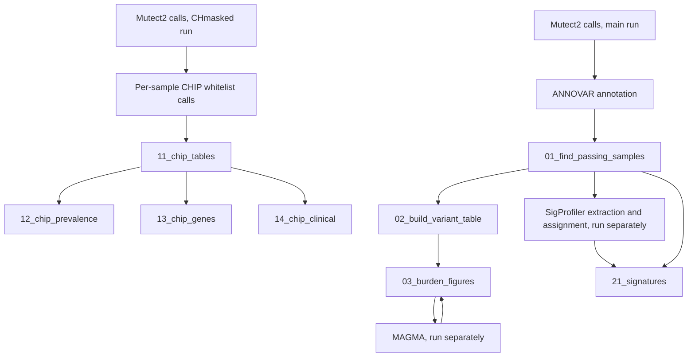

# SSc_Somatic

Analysis code for somatic mutations in blood exome sequencing from a systemic
sclerosis (SSc) cohort. It covers three analyses:

- **Mutation burden**: per-sample somatic SNV and indel counts, their relationship
  with age, age of onset, disease duration, subtype and race, GO biological process
  enrichment of mutated genes, and convergence of somatic NK-cell mutations with
  SSc GWAS signal (MAGMA).
- **Clonal hematopoiesis of indeterminate potential (CHIP)**: CHIP prevalence by
  disease group, gene-specific analyses (DNMT3A, TET2, ASXL1, PPM1D) and
  associations with clinical measures and autoantibodies.
- **Mutational signatures**: SigProfiler de novo and COSMIC-assigned signatures
  compared across disease groups and against clinical measures.

The code is organized as an installable Python package, `SSc_Somatic`, driven by
a study configuration file. The SSc cohort settings are included as a worked
example in `config/example_SSc.yaml`.

The code analyzes variant calls that have already been made and annotated. Its
main inputs are per-sample outputs of ANNOVAR `table_annovar.pl` run on Mutect2
VCFs (hg38): ANNOVAR multianno tables (`.hg38_multianno.txt`) for sample QC and
CHIP calls, and ANNOVAR-annotated VCFs (`.hg38_multianno.vcf`) for the mutation
burden analyses. ANNOVAR must be run with `-vcfinput` and with the RefSeq gene,
cytoband, ExAC, dbSNP, dbNSFP, gnomAD v4 exome, ClinVar and InterVar databases.
The required databases, an example command and the format of each file are
described in [docs/input_specification.md](docs/input_specification.md#overview-of-the-main-inputs).

No data are included in this repository. Patient-level data, clinical metadata
and reference files must be supplied by the user; see
[docs/input_specification.md](docs/input_specification.md).


## Repository layout

```
config/
  example_SSc.yaml          Study configuration: paths, cohort labels, settings
docs/
  pipeline.md               What each notebook reads and writes
  input_specification.md    Required format of every input file
notebooks/                  Analysis notebooks, numbered in run order
src/SSc_Somatic/
  config.py                 Reads the configuration and resolves file paths
  loading.py                load_study(): loads the tables for one analysis
  metadata.py               Cohort groups, age groups and derived columns
  settings.py               configure(): applies the configuration to all modules
  chip/                     CHIP analysis and plotting functions
  burden/                   VCF processing, mutation burden, enrichment and plots
  signatures/               Mutational signature analysis and plotting functions
environment.yml             Conda environment with pinned versions
requirements.txt            pip requirements with pinned versions
pyproject.toml              Package definition
```


## Installation

With conda (recommended):

```bash
conda env create -f environment.yml
conda activate ssc_somatic
```

With pip, in a Python 3.12 virtual environment:

```bash
pip install -r requirements.txt
pip install -e .
```

The pinned versions are those used for the published analysis. The package also
declares minimum versions in `pyproject.toml` for use in other environments.


## Configuration

Every file path, cohort label, clinical column name and analysis setting comes from
a YAML configuration file. To run the analysis:

1. Copy `config/example_SSc.yaml`.
2. Set `data_root` to the folder that holds your data. All input paths in the file
   are relative to it, and generated files are written under `output_root`.
3. Edit the file names and the `cohort` section to match your data.

Each notebook loads the configuration in its first cell:

```python
from SSc_Somatic import configure, load_config, load_study

config = configure(load_config('../config/example_SSc.yaml'))
data = load_study(config, 'chip')      # or 'mutation' or 'signatures'
```

`load_config` reads the file, `configure` passes the cohort labels and column names
to the analysis modules, and `load_study` reads the input tables for one analysis.
`config.check_inputs()` lists which configured input files exist.


## Running the analysis

Run the notebooks in `notebooks/` in numbered order within each analysis:

| Notebook | Purpose |
|---|---|
| `01_find_passing_samples` | Sample QC on ANNOVAR output; writes passing sample IDs and SNV counts |
| `02_build_variant_table` | Combines and filters annotated variants into the tidy variant table |
| `03_burden_figures` | Mutation burden analyses and figures, GO:BP enrichment, NK-cell and GWAS analyses |
| `11_chip_tables` | Builds the CHIP whitelist variant tables |
| `12_chip_prevalence` | CHIP prevalence, disease duration and adjusted odds ratios |
| `13_chip_genes` | Gene-level CHIP analyses |
| `14_chip_clinical` | CHIP associations with clinical measures and autoantibodies |
| `21_signatures` | Mutational signature analyses and figures |

The CHIP notebooks (11 to 14) are independent of the mutation burden notebooks.
The signature analysis follows 01: SigProfiler extraction and assignment are run
separately on the samples that pass `01_find_passing_samples`, and
`21_signatures` then reads the SigProfiler output. See
[docs/pipeline.md](docs/pipeline.md) for the inputs and outputs of each notebook.




## Upstream processing

This package starts from processed variant calls. The following steps were run
separately and are not included:

- Somatic variant calling on hg38 with GATK Mutect2 and FilterMutectCalls
  (GATK 4.2.4.0, tumor-only mode), in two runs: the CHmasked run, in which clonal
  hematopoiesis variants were masked in the gnomAD resource used for calling, for
  the CHIP analysis; and the main run, for the mutation burden and signature
  analyses.
- Variant annotation with ANNOVAR (the release and databases available in
  September 2025), followed by dbSNP and COSMIC filtering. See
  [docs/input_specification.md](docs/input_specification.md#running-annovar) for
  the databases and settings.
- Quality filtering of the annotated calls for the CHIP analysis: read depth of at
  least 20, at least 3 alternate reads, and at least one alternate read in each
  of the F1R2 and F2R1 orientations, following Vlasschaert, Bick and colleagues
  (2023, [doi:10.1182/blood.2022018825](https://doi.org/10.1182/blood.2022018825)), then restriction to clonal hematopoiesis
  genes.
- Per-sample CHIP variant calls against the hotspot whitelist of Vlasschaert,
  Bick and colleagues (2023, [doi:10.1182/blood.2022018825](https://doi.org/10.1182/blood.2022018825)),
  which builds on the CHIP definition of Jaiswal and colleagues (2014,
  [doi:10.1056/NEJMoa1408617](https://doi.org/10.1056/NEJMoa1408617)).
- Mutational signature extraction and COSMIC assignment with SigProfilerExtractor
  and SigProfilerAssignment, run on the samples that pass
  `01_find_passing_samples`.
- MAGMA gene-set analysis of the SSc GWAS summary statistics of López-Isac and
  colleagues (2019, [doi:10.1038/s41467-019-12760-y](https://doi.org/10.1038/s41467-019-12760-y)). `03_burden_figures` writes the MAGMA input
  files and reads the MAGMA output.


## Adapting the code to another cohort

The analyses are written for a cohort of cases and controls in which cases have
**exactly two subtypes** (for SSc, limited and diffuse). Each subtype is compared
with controls and the two subtypes are compared with each other. The labels, the
metadata column names and the clinical measures are all set in the `cohort`
section of the configuration.

Other conventions:

- Sample lists, SNV tables and variant tables identify samples in a column named
  `sample_id`.
- Some analyses are specific to the SSc example and use the SSc clinical data as
  is: the autoantibody analyses (ANA, anti-centromere, anti-topoisomerase,
  anti-RNA polymerase III), the coding of race and ethnicity into the categories
  used in the figures, and the gene-specific CHIP analyses. These need adapting
  for cohorts with different clinical variables.


## Author

Brecca Miller (brecca797@gmail.com)


## License

MIT. See [LICENSE](LICENSE).
